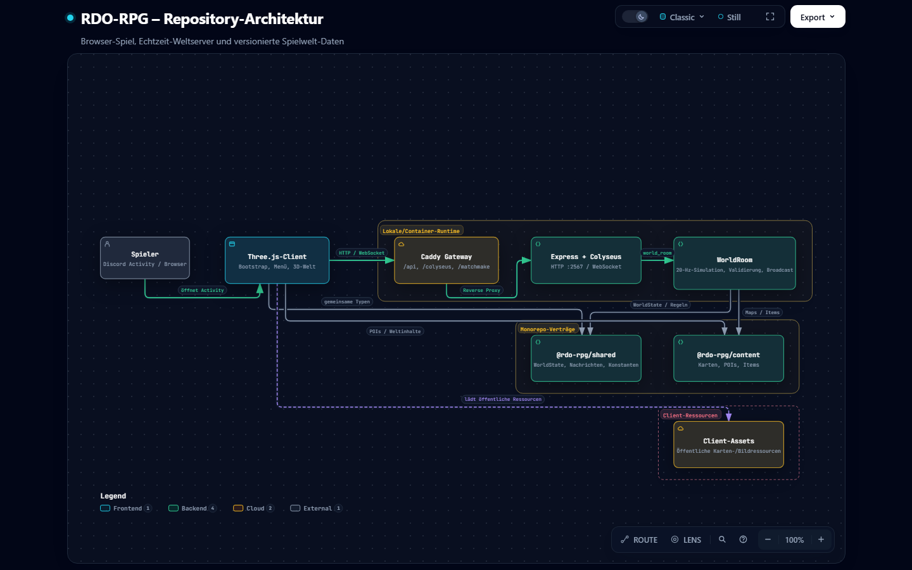

# RDO-RPG

Western-RPG für Browser und Discord Activity mit **Three.js, TypeScript, Vite und Colyseus**. Ziel ist ein wiedererkennbares, gut spielbares Valentine in 2,5D.

## Einstieg

- [Dokumentation und Quellen](docs/README.md)
- [Arbeitsregeln](AGENTS.md)
- [Aufgaben, Prioritäten und aktuelle Abnahmen in Linear](https://linear.app/h4real82/project/rdo-rpg-d9ca7fe5de94)
- [Obsidian als Wissens-Vault](docs/knowledge-vault.md)

## Lokal starten

Node.js 20+ und die in `package.json` festgelegte pnpm-Version verwenden:

```powershell
npx pnpm install --frozen-lockfile
npx pnpm -r build
npx pnpm dev
```

Client: `http://localhost:3000`; Server: `http://localhost:2567`. Discord-Zugangsdaten nur in lokalen Umgebungsvariablen ablegen.

Ein frischer Clone enthält keine lokalen Rohdaten oder generierten Runtime-GLBs. Der [Restart-Pipeline-Guide](https://github.com/h4real82/RDO-RPG/blob/codex/rdo-restart-foundation/docs/runbooks/asset-pipeline.md) beschreibt den lokalen Asset-Aufbau.

## Arbeitsstände

| Stand | Zweck |
| --- | --- |
| `main` | Veröffentlichter Three.js-/Colyseus-Grundstand |
| [`codex/rdo-restart-foundation`](https://github.com/h4real82/RDO-RPG/tree/codex/rdo-restart-foundation) | Modulare Client-/Weltimplementierung und Pipeline |
| Lokaler Hauptcheckout | Kann weitere unveröffentlichte Änderungen enthalten; vor Arbeit `git status` prüfen |

Ein Branch-Push ist kein Merge nach `main`. Lokale Vorschau, datierte Prüfergebnisse und produktiver Onlinebetrieb sind getrennte Aussagen. Karte, Innenräume, durchgängige Laufwege und Mehrspielerbetrieb brauchen jeweils eigene Abnahme; aktuelle Kriterien stehen in Linear.

## Architektur

| Verzeichnis | Verantwortung |
| --- | --- |
| `apps/client` | Three.js, Vite, Darstellung, Eingabe und UI |
| `apps/server` | Express, Colyseus, autoritative Spielzustände und Discord-Tokenaustausch |
| `packages/shared`, `packages/content` | Gemeinsame Typen, Colyseus-Schemas und Inhalte |
| `infra` | Caddy und Docker |
| `packages/world-contracts`, `tools/rdo_pipeline` im Restart | Weltverträge, Import und Quellenprüfung |



## Daten und Wissen

GitHub führt Quellcode, Schemas, Pipeline-Werkzeuge und ausgewählte Dokumentation. `data/raw/` bewahrt lokale Originale; `data/runtime/` enthält erzeugte Laufzeitdaten. Binäre Modelle und Texturpakete bleiben lokal.

Linear führt Aufgabenstatus und Abnahme. Das persönliche Vault unter `docs/Obsidian/` erklärt Entscheidungen und Zusammenhänge und bleibt aus Git ausgeschlossen. Die [versionierte Vault-Grundstruktur](docs/vault-starter/Index.md) macht den Aufbau nachvollziehbar. Es gibt keine automatische Obsidian-/GitHub-/Linear-Synchronisierung.

Historische Planungen sind entsprechend gekennzeichnet. Frühere Testzahlen und Dashboards sind keine aktuelle Fortschrittsanzeige; [der Stand vom 16.10.2026](docs/Project-Status-2026-10-16.md) bleibt als datierte Evidenz erhalten.
