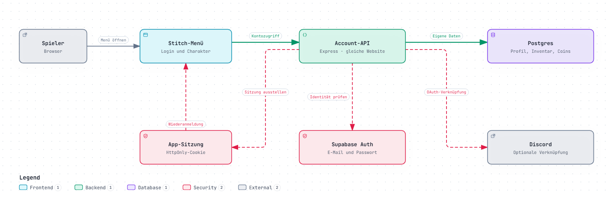
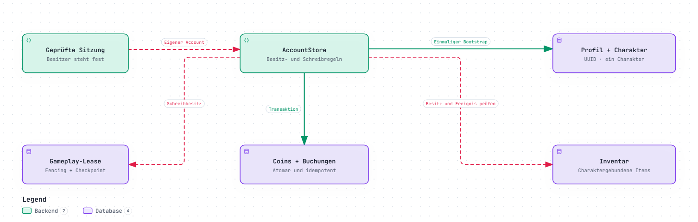
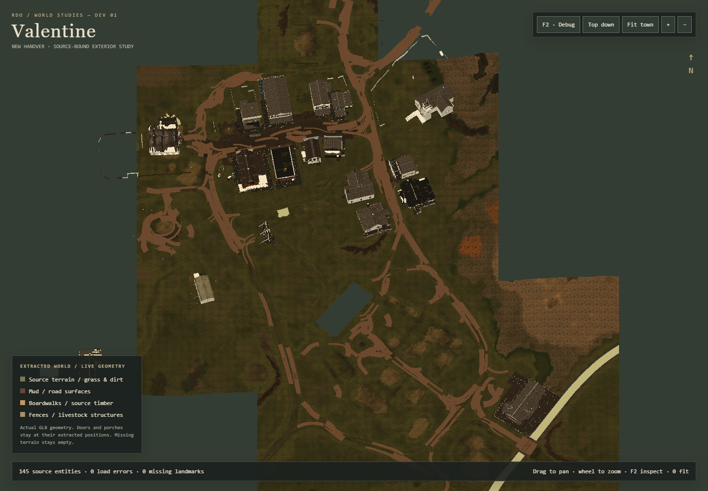
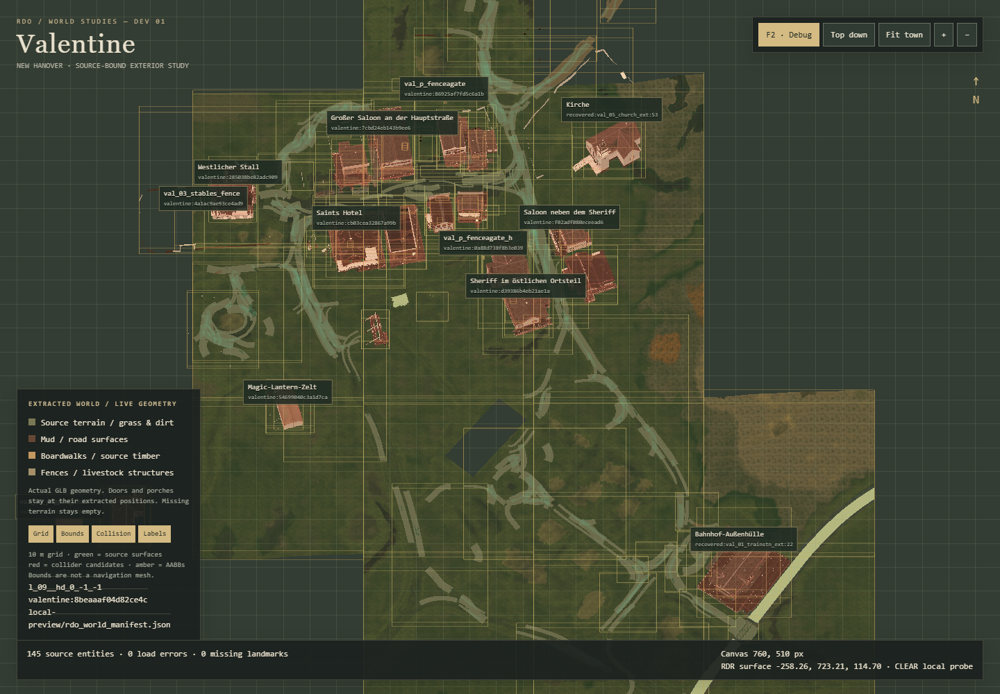
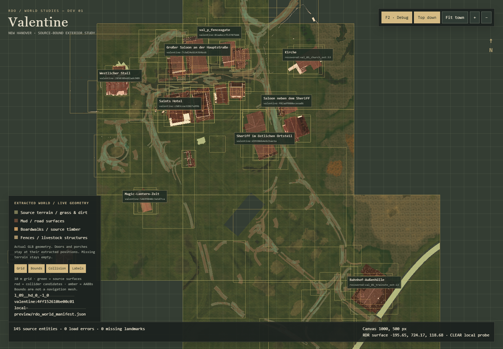

# RDO-RPG

## Changelog · 19.10.2026 · Spielerprofil und Menü

- Stitch-basierte Anmelde-/Registrierungsansichten und Charakterseite mit eigenem Inventar, Coins-Konto und Buchungen ergänzt. Wiederherstellung, Passwortänderung und Abmeldung sind an die neue Account-API angeschlossen. **Google entfällt auf Benutzerwunsch.**
- Serverseitiges E-Mail-Konto mit geschützter Browsersitzung; feste Account-UUID, einmaliger Starterbestand und transaktionales Coins-Ledger. Bestehende Charakter-/Inventartabellen werden weiterverwendet; kein Browser-Guthaben als Wahrheit.
- Lokale SQL-/API-/Browserprüfungen vorhanden. **Noch kein Livebetrieb:** Datenbankzugang, Auth-E-Mail-Konfiguration und Schemafreigabe fehlen. Die Solo-Vorschau bleibt ungespeichert; private/Discord-Sessions und Sessionboni sind noch nicht verfügbar. Build und Stubtests ersetzen diese Abnahme nicht.
- [Einrichtung, Prüfungen und Git-Übergabe](docs/runbooks/player-accounts.md) · [H4R-61](https://linear.app/h4real82/issue/H4R-61), [H4R-35](https://linear.app/h4real82/issue/H4R-35), [H4R-87](https://linear.app/h4real82/issue/H4R-87).

**Archify: Anmeldung und Profil** — logische Übersicht des lokalen Integrationsstands; keine Behauptung eines Live-Deployments. [Interaktive HTML-Datei](docs/architecture/account-access.html).



**Archify: dauerhafte Besitzdaten** — lokale Repository-/SQL-Funktionen; der Welt-Autosave ist noch nicht angeschlossen. [Interaktive HTML-Datei](docs/architecture/account-state.html).



**Umgesetzt 18.10.2026 (aktiver Restart):** Kontextkamera und aktive Erdgeschossansicht für Bank/Smithfield’s, außen Shift-/Kontext-Rennen und innen Gehen, nahe Ausgangs-/Aktionshinweise. Saloon mit einfacher Theke, zwei Tischen und Darts-Wandanker. Gebäude-/Spielregister angebunden; Darts nutzt seinen eigenen Codeordner und eine validierte Variante. 147 Client-Tests, Workspace-Build, Bank-/Saloon-Rundlauf, Produktions-Darts Desktop/mobil, zwölf Input-Guard-Fälle und zehn Appzyklen bestanden. Weitere Häuser, Galerie/Treppen und visuelle Originalerkennbarkeit bleiben offen. [Prüfprotokoll und nächste Arbeiten](docs/planning/Context-Interiors-Implementation-Ledger.md). Keine neue Benutzer-Zuarbeit. Main erhält Dokumentation; Runtime bleibt im Restart.

**Spielziel18.10.2026:** Wiedererkennbares Valentine in2,5D, keine1:1-Rekonstruktion. Vereinfachte Zugänge, Rampen, Kollision und Innenräume sind erlaubt; L22 entfällt. [Aktuelle Designentscheidung](docs/planning/Valentine-25D-Designentscheidung-2026-10-18.md).

**Nachtrag18.10.2026:** Strahlkosten beim Saloon-Anlauf reduziert, frühere Nahtransparenz vor Wandkontakt geprüft; Kollision bleibt. [Messung, Prüfungen und offene Grenzen](docs/planning/Performance-Proximity-Validation-2026-10-18.md). H4R-49/32/29 bleiben In Progress. Reset und reduzierte Animation vom Benutzer bestätigt.

**Fortschritt18.10.2026:** Selektive Gebäudetransparenz korrigiert: Materialslots unabhängig, nur tatsächliche physische Treffer verblassen, Sichtstrahl zum sichtbaren Spielerzentrum. Saloon/Bahnhof/Kirche und Straße0059/13↔18 geprüft;101 Clienttests und Builds bestanden. [Abnahme und offene Etagen-/Routenpunkte](docs/planning/Occlusion-Isolation-Validation-2026-10-18.md). H4R-32/29 bleiben In Progress; aktive Runtime im Restart.

**Aktualisierung 18.10.2026:** [Straßenrücksetzung und Menüfeedback](docs/planning/Recovery-Menu-Validation-2026-10-18.md) im aktiven Restart umgesetzt und lokal abgenommen (H4R-84/85). Unter http://127.0.0.1:4180/ neu laden; Solo → Menü → „Zur Straße zurücksetzen“. Exakter Header, animiertes Licht/Partikel, Blur und reduzierte Bewegung. 97 Clienttests,12 Guardfälle,10 DEV- und3 Produktionszyklen sowie Pflicht-Builds bestanden; Umfang siehe Bericht. Keine allgemeine Kollisions-/Routen- oder Onlineabnahme. Main erhält Dokumentation; Runtime bleibt im Restart. [Deine optionale Aufgabenliste](docs/Valentine-Nebenaufgaben-2026-10-17.md).

**Aktualisierung 17.10.2026:** Im aktiven Restart jetzt 150 Platzierungen / 25 Terrain-Tiles. [Batch08](docs/Valentine-Terrain-Batch08-2026-10-17.md): drei Exporte übernommen, 111 zusätzliche Bodentreffer; 1009/1657 Treffer, 648 fehlend, 39 weitere Quell-Bounds offen. [Stitch-App-Shell](docs/planning/Frontier-Shell-Validation-2026-10-17.md) im normalen lokalen Build unter http://127.0.0.1:4180/; gewählter Screen mit Header, linker Navigation und drei Moduskarten. Client86/86 und Pflicht-Build bestanden. [Aktuelle Aufgaben für dich](docs/Valentine-Nebenaufgaben-2026-10-17.md): keine erneuten Exporte/URLs nötig. Ältere Zahlen unten bleiben als damalige Zwischenstände lesbar; Main- und Restart-Runtime sind weiterhin getrennt.

App-/Social-Hub-Fahrplan: [Planung und Einstieg](docs/Valentine-App-Planung-2026-10-17.md),
[Meilensteine](docs/planning/Valentine-Milestone-Roadmap-2026-10-17.md).
Die DEV-Ansicht `?view=app-concept` verbindet bedienbare Menüs mit der echten lokalen
Solo-Szene; Darts ist als lokale Übung verfügbar, Multiplayer und weitere Minigames bleiben geplant.
Frische DEV-Abnahme: [Prüfbericht](docs/planning/App-Concept-Validation-2026-10-17.md).
Aktive Eingaben und Fehlererholung: [H4R-33-Audit](docs/planning/Input-Guards-Audit-2026-10-17.md),
85 Client-Tests, zwölf Guard-Browserfälle und zehn App-Sessionzyklen bestanden.
Zum parallelen Mitmachen: [Nebenaufgaben und vorbereitete Dateien](docs/Valentine-Nebenaufgaben-2026-10-17.md).

Western-RPG als Discord Activity mit **Three.js, TypeScript, Vite und Colyseus**.
Stand: **17.10.2026**. Schwerpunkt ist die quellenbasierte Rekonstruktion der
Valentine-Außenwelt; vollständige Karte und Multiplayer-Vertikalschnitt sind noch
nicht abgenommen.

## Aktueller Stand

- **Bahnhof und Kirche:** Die originalen HD-Außenplatzierungen sind gefunden.
  Der frische Audit bestätigt für beide Modelle `source-placement-found`.
  Dafür ist derzeit kein weiterer OpenIV-Export erforderlich.
- **Runtime:** Spiel und Inspector laden dieselbe gehashte `verified-scene` mit
  146 Platzierungen einschließlich Bahnhof und Kirche. Davon sind 21 Terrain-Tiles.
- **Ortsgrenze:** Benutzerkontur mit fünf Originalankern und sechs Kontrollen
  registriert (126 Punkte, geschätzte Bildunsicherheit ±8.3 m). Client und
  separater `valentine_source`-Serverraum prüfen denselben Grenzvertrag;
  der Inspector zeigt die Kontur über „Ortsgrenze“. Die lokale Vorschau
  ist noch nicht vernetzt; Legacy-Pixelraum und volle Serverphysik bleiben offen.
- **Terrain und Route:** Sieben nachgelieferte Original-Terrainressourcen sind
  integriert. 17 zuvor betroffene Quellanker treffen echte Bodendreiecke;
  sieben lokale Abschnitte sowie der begrenzte Straßenabschnitt 0062/12↔20
  sind in beiden Richtungen mit aktiver Kollision bestanden. Im registrierten
  Gesamtumfang schneiden 64 HD-Terrain-Bounds die Kontur: 21 integriert,
  43 weitere Akquisitionskandidaten. Im 10-m-Raster fehlen 801 von 1657
  Bodenproben. Vollständige Rundweg-/Serverabnahme bleibt offen.
- **Frische Validierung:** 145 Pipeline-Tests, 85 Client-Tests, 14 Vertrags-Tests
  plus zwei Node-Checks, Grenzprüfung im Browser und Socket-Test bestanden.
  Runtime-Validierung, begrenzte Routenprüfung
  und Pflicht-Build im Restart bestanden; keine Lade-/Textur-/Konsolenfehler.
  Vite warnt weiterhin vor CJS-Abkündigung und großen Bundles.

Quellkoordinaten, Prüfbedingungen und offene Abnahmen:
[Aktuelles Issue-Runbook](docs/runbooks/valentine-issue-remediation.md).
Der [Projektstand vom 16.10.2026](docs/Project-Status-2026-10-16.md) bleibt als Historie erhalten.

## Branches und Arbeitsstände

| Stand | Zweck |
| --- | --- |
| `main`, lokal `D:/Projects/RDO-RPG` | Bestehender Three.js-/Colyseus-Prototyp; viele zusätzliche lokale Änderungen |
| [`codex/rdo-restart-foundation`](https://github.com/h4real82/RDO-RPG/tree/codex/rdo-restart-foundation) | Aktive Restart-Implementierung: modularer Client, Weltverträge, Python-Pipeline und Tests |

Der Restart liegt lokal unter
`C:/Users/h4rea/.codex/worktrees/rdo-restart-foundation/RDO-RPG`.
Sein Branch-Push ist noch kein Merge nach `main`. Die Pipeline-/Client-Tests oben
beziehen sich auf den Restart. Ein frischer Clone enthält keine lokalen Rohdaten
oder generierten Runtime-GLBs.

## Architektur

- `apps/client`: Three.js, Vite und TypeScript. Der Restart kapselt Bootstrap,
  Weltstreaming, GLB-Cache, orthografische Kamera, Bewegung, Geländeprüfung,
  Kollisionen, HUD und Interaktionen unter `src/game/`.
- `apps/server`: Express, Colyseus und Discord-Tokenaustausch als Grundlage
  des autoritativen Servers. Die lokale Restart-Vorschau belegt noch keinen
  erfolgreichen Discord-/Zwei-Client-Test.
- `packages/shared` und `packages/content`: gemeinsame Netzwerktypen,
  Colyseus-Schemas und Inhaltsdaten.
- `packages/world-contracts` und `tools/rdo_pipeline` **im Restart-Branch**:
  Weltverträge, Koordinatenkonvertierung, Exportinventar, Provenienz,
  Manifestaufbau und Diagnosewerkzeuge.
- `infra`: Caddy und Docker. Deployment wurde in dieser Sitzung nicht neu geprüft.

## Lokal starten

Node.js 20+ und die in `package.json` festgelegte pnpm-Version verwenden.
Im gewünschten Checkout:

```powershell
npx pnpm install
npx pnpm -r build
npx pnpm dev
```

Client: `http://localhost:3000`; Server: `http://localhost:2567`.
Die Restart-Vorschau benötigt zusätzlich lokal erzeugte Daten unter
`data/runtime/valentine/local-preview/`.
Aufbau und Prüfungen: [Pipeline-Runbook im Restart](https://github.com/h4real82/RDO-RPG/blob/codex/rdo-restart-foundation/docs/runbooks/asset-pipeline.md).
Discord-Zugangsdaten gehören in lokale Umgebungsvariablen; Client-Secret und
Service-Keys dürfen nie ins Clientbundle oder Git gelangen.

## Daten und Qualitätsgrenzen

- GitHub führt Quellcode, Dokumentation, Schemas und Pipeline-Tools.
  Originalmodelle, Texturpakete und generierte GLBs bleiben lokal.
- `data/raw/` bleibt unverändert; `data/runtime/` enthält generierte Ausgaben.
  Bereits versionierte kleine Runtime-Konfigurationen im Restart sind keine
  Modellpakete; Git-Ignore entfernt zuvor getrackte Dateien nicht rückwirkend.
- `Media/` und belegte Originaltransformationen bestimmen den Kartenabgleich.
  Ein Modellname oder ein grüner Build belegt keine korrekte Platzierung.
- Supabase ist für relationale Spielzustände vorgesehen. Neue Live-Migrationen,
  Autosave und Storage-Uploads wurden mit diesem Abgleich nicht ausgeführt.

## Aufgaben und nächste Abnahmen

[Linear führt den aktuellen Status](https://linear.app/h4real82/project/rdo-rpg-d9ca7fe5de94).
Historische Dashboards und Checkboxen sind keine Live-Fortschrittsanzeige.
Es besteht keine automatische Obsidian-/GitHub-/Linear-Synchronisierung.

1. [H4R-52](https://linear.app/h4real82/issue/H4R-52): Quellplatzierungen Bahnhof/Kirche nachgewiesen, abgeschlossen.
2. [H4R-27](https://linear.app/h4real82/issue/H4R-27): Exteriors mit Provenienz integrieren und gegen Media abgleichen.
3. [H4R-28](https://linear.app/h4real82/issue/H4R-28) und [H4R-29](https://linear.app/h4real82/issue/H4R-29): Terrain und Client-/Server-Kollision abnehmen.
4. [H4R-30](https://linear.app/h4real82/issue/H4R-30): vollständigen Kernrundweg mit Kollision und ohne Noclip abnehmen.

Dokumentationsabgleich: [H4R-50](https://linear.app/h4real82/issue/H4R-50).

## DEV-Karteninspektor (H4R-53)

Im Restart-Checkout `npx pnpm --filter @rdo-rpg/client dev --host 127.0.0.1`
starten und `http://127.0.0.1:3000/?view=inspector` öffnen.
Diese Ansicht ist ausschließlich im Vite-DEV-Modus verfügbar.

- Quellraum `(x,y,z)` wird unverändert nach Three.js `(x,z,-y)` abgebildet;
  die Kamera ist nordorientiert. Tiefe/Höhe der echten GLBs bestimmen die Verdeckung.
- Spiel und Inspector verwenden dieselben 146 Platzierungen aus
  `verified-scene/rdo_world_manifest.json`. Die ursprüngliche `local-preview`
  bleibt erhalten; der Inspector ergänzt keine privaten Landmarken mehr.
- F2 oder Debug: 10-m-Raster, Canvas-/Quellkoordinaten am Cursor, Landmarken-IDs,
  AABBs und eingefärbte Originalgeometrie. Grid, Bounds, Collision und Labels
  lassen sich unabhängig schalten. Ziehen bewegt die Kamera, Mausrad/+/- zoomt,
  Top down wechselt zur Draufsicht, 0/Fit town passt den Ortsausschnitt ein.
- Grün zeigt Quelloberflächen, Rot Kollisionskandidaten, Amber Objektgrenzen.
  Der Cursor prüft zwei lokale Übergänge über die bestehenden Terrain-/Mesh-Routinen.
  Das ist kein Navmesh oder Beweis für vollständige Begehbarkeit. Fehlendes Terrain
  und unvollständige Straßenflächen werden weder aufgefüllt noch verbreitert.
- Typnamen beeinflussen nur visuelle Kategorien, niemals Maße oder Positionen.
  Fehlende Assets/Quellnachweise werden in der Ansicht gemeldet.

Prüfung: 142 Pipeline-Tests und `npx pnpm -r build`; frische Browserchecks für
145 geladene Objekte, gemeinsame Szene, Bodendreiecke und lokale Laufabschnitte.
Die frühere Prüfung von F2, Koordinaten, Einzeltoggles und Pan/Zoom/Fit bleibt dokumentiert.
Die vollständige Routen-/Server-Kollisionsabnahme bleibt bei H4R-27/H4R-29/H4R-30.
Auftrag: [H4R-53](https://linear.app/h4real82/issue/H4R-53).

## Bilder aus der DEV-Prüfung vom 16.10.2026

Die Aufnahmen zeigen den [Restart-Branch](https://github.com/h4real82/RDO-RPG/tree/codex/rdo-restart-foundation)
mit 145 quellengebundenen Objekten einschließlich Bahnhof und Kirche.
Der DEV-Inspektor ist noch nicht in `main` integriert. Sichtbare Terrainlücken
und unvollständige Straßenflächen sind weiterhin offene Abnahmepunkte.

**Ortsübersicht – orthografische 2.5D-Ansicht:**



**F2-Debug – Raster, Landmarken-IDs, Objektgrenzen und Quelloberflächen:**



**Draufsicht – Norden oben, Bahnhof im Südosten und Kirche im Nordosten:**



Diese Bilder belegen den Darstellungs-/Inspektionsstand, keine vollständige
Routen- oder Server-Kollisionsabnahme. Auftrag:
[H4R-53](https://linear.app/h4real82/issue/H4R-53).

## Lizenz

MIT für den Projektcode. Daraus folgt keine Weitergabeerlaubnis für lokale
Rockstar-Originalassets; diese sind kein Bestandteil des Quellcode-Pushs.
